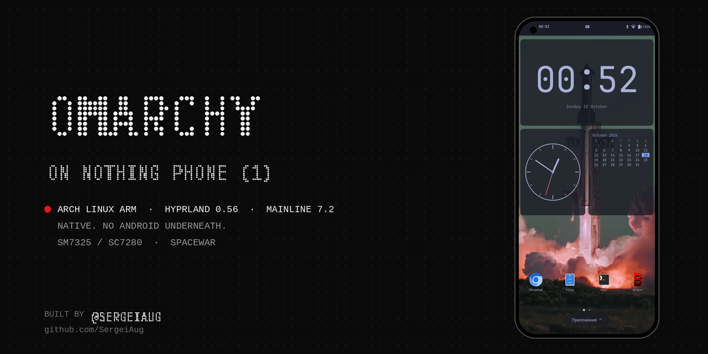
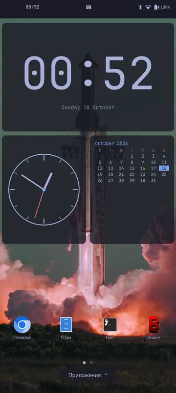
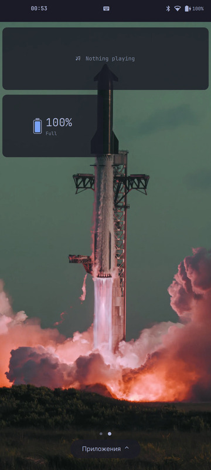
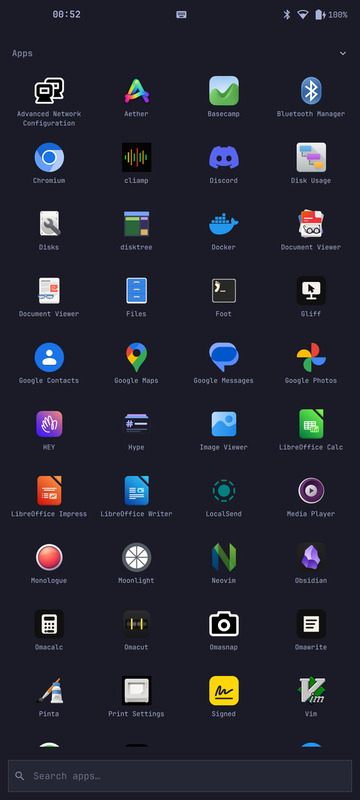
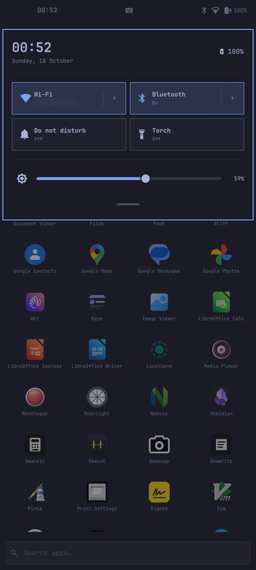

# Omarchy on Nothing Phone (1)

Real [Omarchy](https://omarchy.org) running natively on the Nothing Phone (1) "Spacewar". It runs Arch Linux ARM, Hyprland and Omarchy's own packages straight on the phone, with a mainline kernel and no Android underneath.

> Status: **work in progress.** It is a pocket computer today, not yet a phone.

Built by [@SergeiAug](https://github.com/SergeiAug), with help from AI coding tools.

| | |
|---|---|
| **Device** | Nothing Phone (1), SM7325 / sc7280, Adreno 642L, 1080x2400 |
| **Kernel** | 7.2.9 from [sc7280-mainline](https://github.com/sc7280-mainline/linux) plus the Spacewar series (`pkgs/linux-sc7280`) |
| **System** | Arch Linux ARM, `omarchy-dev` from Omarchy's aarch64 edge repo, Hyprland 0.56.2 |
| **Works** | GPU, touch, Wi-Fi, Bluetooth, both speakers (PipeWire), USB networking, torch, modem stack |
| **Not yet** | calls, cameras, GPS, sensors, PIN lock, power saving |

## Screenshots

   

## Mobile shell

`pkgs/nothing-spacewar-mobile-shell` turns Omarchy's own Quickshell shell into a phone UI with plugins, not a fork:

- home screens with widgets and an app drawer with search, from [derekross/omarchy-mobile](https://github.com/derekross/omarchy-mobile);
- 105 widgets from [SimonSchubert/omarchy-widgets](https://github.com/SimonSchubert/omarchy-widgets);
- a shade that follows your finger, bottom swipes for home and recents, and back from the side edges, adapted from [SimonSchubert/omarchy-mobile](https://github.com/SimonSchubert/omarchy-mobile) and [Cube-Oakley/omarchy-mobile](https://github.com/Cube-Oakley/omarchy-mobile);
- an on-screen keyboard with English and Russian layouts, from a fork of [yeutterg/omarchy-on-screen-keyboard](https://github.com/yeutterg/omarchy-on-screen-keyboard).

## Layout

| Path | Contents |
|---|---|
| `pkgs/` | PKGBUILDs: kernel, firmware packaging, boot image, audio UCM, modem stack, mobile shell, keyboard |
| `tools/` | rootfs + boot image builder, a 122-check image verifier, export with checksums |
| `docs/notes.md` | how it was done: the problems we hit and how each was solved |
| `docs/README.ru.md`, `docs/flashing.ru.md` | detailed state, flashing and rollback (Russian) |

## Build

1. Build the packages once with `makepkg` in each `pkgs/*` directory: kernel, firmware, boot, UCM, mobile shell, keyboard. The modem packages are prebuilt for aarch64.
2. `sudo tools/build-rootfs.sh <name>` builds `boot.img` and a sparse `userdata` image with Omarchy and the mobile shell, then `tools/verify-image.sh` runs 132 checks.
3. Flash `boot_a`, `boot_b` and `userdata` with fastboot, as `docs/flashing.ru.md` describes.

## Safety

Only `boot_a`, `boot_b` and `userdata` are ever flashed. Back up the modem EFS partitions (`modemst1`, `modemst2`, `fsg`, `fsc`, `persist`) before anything else, and run `rmtfs` read-only. Firmware is not redistributed here: it comes from your own device. Use at your own risk on a phone you can afford to lose.

## Licenses

Our scripts and shell code are MIT. Kernel patches are GPL-2.0. Third-party parts keep their own licenses, see `pkgs/nothing-spacewar-mobile-shell/ATTRIBUTION.md`.

## Contact

Questions, ideas and your own setups: [Discussions](https://github.com/SergeiAug/omarchy-nothing-phone/discussions). Bugs: [Issues](https://github.com/SergeiAug/omarchy-nothing-phone/issues).
